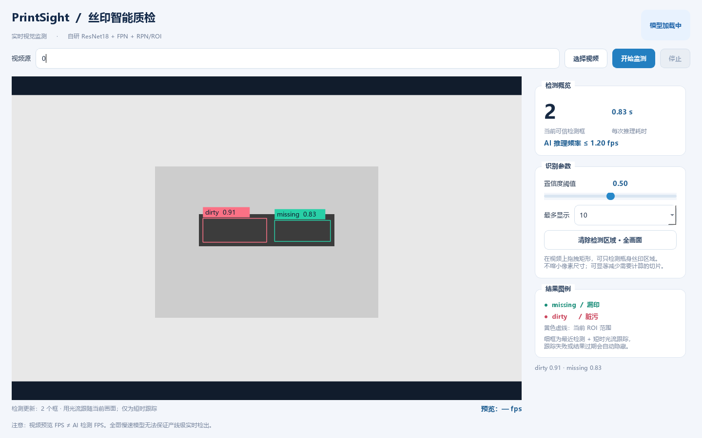
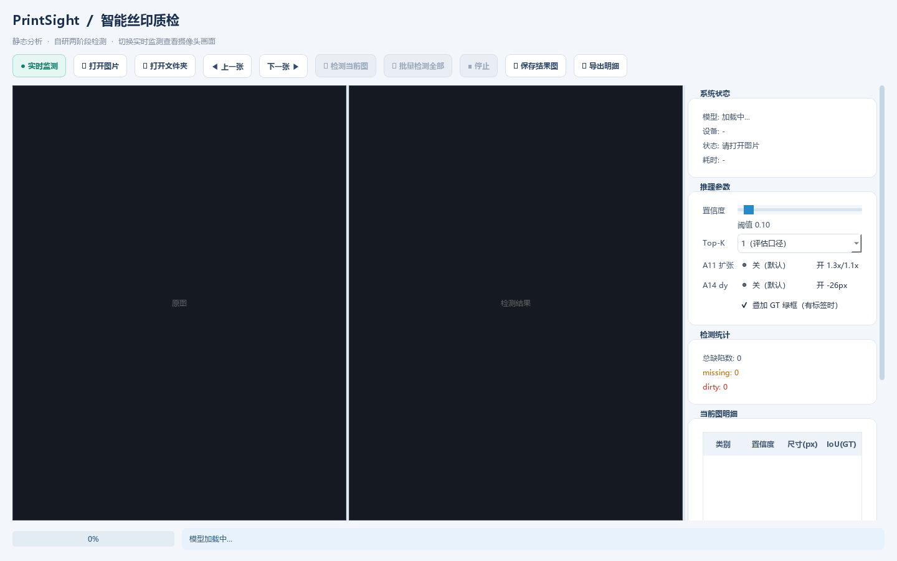

# PR4-A：PrintSight 视频监测与前端重设计

**目标仓库**：`Faputaaaaaa/look`
**适用基线**：`main` @ `767724cf47c507d9388e3988887cd581a34d090b`（2026-10-19）
**建议 PR 标题**：`feat(platform): add live camera/video inspection and refreshed light UI`

## 用户目标

单独检测图片之外，可以打开电脑摄像头、USB 摄像头、视频文件及标准 RTSP 流，实时看到视频画面；AI 判断有缺陷时使用极细颜色框显示相应位置，随着画面中的目标短时移动；界面现代、信息有层级，便于生产人员使用；尽可能提高推理可用性而不牺牲缺陷原始像素。

## 本 PR 包含什么

1. `defect_platform/live_ui.py`：全新清爽浅色「PrintSight 实时监测」页面，源输入/启动/停止/自动状态、ROI 鼠标拖拽、置信度和 Top-K、缺陷统计、预览 FPS/模型推理耗时分开显示，支持 PyQt5/PySide6。
2. `defect_platform/live_core.py`：**容量 1** 的最新帧邮箱（慢模型不排队）、ROI 像素裁切与 bbox 坐标回映、基于 OpenCV LK 光流的短时位置跟踪、过期结果拒绝。
3. `defect_platform/theme.py`：旧静态图页面改为现代浅色高对比配色，按钮/统计/面板层次不同，不再通篇深灰；同时移除旧 `_apply_qss()` 深色样式（它会在浅色主题之后残留到子控件 palette，导致右侧面板深底深字）。
4. `defect_platform/platform_ui.py`：增加「实时监测」入口；**复用已加载的模型**（在 GUI 切换期间不重复占用 GPU），另支持 `--live` 启动；右侧信息面板改为可滚动，避免 900px 高度下卡片被压缩重叠。
5. `defect_platform/start_live.bat`：Windows 一键启动直播模式，复用旧 BAT 的 Python/torch/PyQt 检查逻辑。
6. `tests/test_live_core.py`：15 个针对纯 CPU 核心逻辑的测试，涵盖 ROI、帧覆盖、坐标映射、过期隐藏、光流移动。
7. `docs/PR4_LIVE_PLATFORM.md`：本文。

**不修改** `model_fpn.py`、`train.py`、`config.py`、`split.json`、PR2 manifest 格式、`sahi_inference.py` 的评估行为。PR3 模型与旧静态平台可保持。

## 如何使用

```bat
rem 在项目根目录执行
defect_platform\start_platform.bat
rem 点击「● 实时监测」

rem 或直接打开实时监测页面
defect_platform\start_live.bat

rem 命令行指定摄像头/视频/RTSP
python defect_platform\live_ui.py --source 0
python defect_platform\live_ui.py --source "D:\video\bottle.mp4"
python defect_platform\live_ui.py --source "rtsp://192.168.1.100:554/stream"
```

视频源输入 `0`、`1` 等对应 Windows 摄像头设备编号；视频文件会按文件中的 nominal FPS 播放；RTSP 需要设备支持且网络可连接。海康等工业相机若只能通过 MVS/GenICam SDK 访问，则需要额外封装该 SDK 的取帧适配器，**当前代码未宣称支持这些私有协议**。

**使用流程**：启动 → 看到视频 → 用鼠标在丝印区域拖矩形 → 观察细框和状态。拖动 ROI 或切换视频源后，旧检测结果会废弃，防止错误贴到新画面。

## 精度与速度边界

- **视频预览帧率与 AI 推理帧率是两件事**。旧完整图 4096×2736 需要 96 个 640×640 SAHI 切片，先前项目状态记录单张约 15–17 秒；按该性能不能承诺每个经过镜头的瓶子都在下一帧完成检测。
- 新界面使用 25 fps **上限**的最新帧式预览队列和独立 AI 推理线程，视觉画面不会被模型阻塞；这不是宣称模型达到了 25 fps。
- 选定 ROI 后只用原始图像的该矩形区域推理，不先下采样微小缺陷。ROI 为 640×640 时只有 1 个 SAHI 切片（与 96 个全图切片相比数量显著减少），但实际加速比需在目标设备上测量。
- 默认 ROI 为空时仍处理整个画面；非常大的高分辨率摄像头必须选好固定丝印区域后再尝试生产模式。
- 对于每次检测返回较晚的结果：仅接受还在最近 **2.5 秒**视频历史内的检测，并使用 LK 光流作短时图像位置传播；检测结果过期直接丢弃，不能错误地把框留在新瓶上。
- 光流只作**视觉辅助跟踪**，不产生新缺陷判断、不更新置信度；当瓶身外观变化过大、光流丢失、重复纹理或切换物理瓶时会失败；单瓶追踪、跨瓶切换仍需工业现场校准/线体触发信息。
- 视频框是 **1.5px 细线**，缺印绿色、脏污红色，所有类别可以同时保留多个框，Top-K 可选 3/5/10/20；阈值默认为 0.50。
- 高分辨率录入对小缺陷至关重要。对低分辨率电脑摄像头的检测准确度不可沿用 4096×2736 数据集指标。

## 测试

2026-10-19 在本机（Windows，`D:\Python3.14`，torch + PyQt5 已安装）实际执行：

```bash
python -m unittest discover -s tests -p test_live_core.py -v   # 15/15 OK
python -m unittest discover -s tests -t .                      # 64/64 OK（含既有 49 项）
python -m py_compile defect_platform/platform_ui.py defect_platform/live_ui.py \
                     defect_platform/live_core.py defect_platform/theme.py
```

- 无头 Qt（`QT_QPA_PLATFORM=offscreen` + `QT_QPA_FONTDIR=C:/Windows/Fonts`）实际构建并渲染了两个窗口：
  `LiveWindow` 与 `PlatformUI`，布局、浅色配色、ROI 与细框绘制均正常。

  

  
- 修正了补丁初版的一个真实缺陷：`PlatformUI._apply_qss()` 的深色 QSS 在 `LIGHT_THEME` 之前执行，
  子控件 palette 残留 `#0f1115`（右侧面板深底深字，不可读）。已删除该旧方法，只应用 `LIGHT_THEME`；
  右侧面板同时改为 `QScrollArea`，避免 900px 高度下卡片被压缩重叠。

**仍未验证（必须现场做）**：真实摄像头 / MP4 / RTSP 取流，模型 GPU 推理时延与吞吐，
连续 10 分钟稳定性与内存曲线，跨瓶跟踪与产线触发。以下验收清单仍需在目标机器执行。

本轮验收清单：
1. Windows PyQt5 中打开主平台 → 点击「实时监测」→ 切回静态图，不重复加载 GPU 权重；
2. 0/1 号摄像头、MP4、RTSP 可启动和停止；无设备/断流/视频结束不崩溃；
3. 连续 10 分钟检查预览流畅性、内存曲线、QThread 生命周期及停止响应；
4. 选 ROI/清除 ROI，bbox 按原视频像素正确回映，固定点与运动场景抽帧核对；
5. 同画面两个不同类别缺陷能画两个细框，跟踪框可随平移移动，旧帧不误画到新瓶；
6. Full、ROI、ROI+其他优化的 `AI latency p50/p95` 和 throughput 分别记录；固定曝光、分辨率、真实设备。
7. 做统计检验：新 ROI 模式的缺陷 Recall、漏检、误报等不能仅以可视化替代；跨瓶型未见测试保留 PR2 合同。
8. 旧静态图 `smoke_ui.py`、`smoke_test.py` 与训练 42 项既有单测仍需在项目仓库重跑。

## 下一 PR4-B

- 对 `sahi_inference` 批量切片预处理和 batched forward 作受控实验；GPU 8GB、RPN proposal 张量内存、潜在 OOM 需专门测量。
- 研究 TensorRT / torch.compile / FP16（不承诺所有算子都支持）；对超小印刷缺陷做对照。
- 工业相机 MVS/GenICam 异步抓帧、光电触发与瓶子唯一 ID、缓存中的帧时间戳关联、阈值门控。
- 最终产线实际能力要以瓶子通过时间、相机视野覆盖和“漏报一个缺陷的代价”为验收标准。

## GitHub 状态

- 仓库：`Faputaaaaaa/look`，基线 `main` @ `767724cf47c507d9388e3988887cd581a34d090b`
- 分支：`feat/pr4-live-inspection`（功能提交 `8aba7b9`，其后仅追加本文档的状态更新）
- Pull Request：<https://github.com/Faputaaaaaa/look/pull/1>

本 PR 只新增实时监测模块与浅色主题改动，不改训练/评估口径，也不改动 `model_fpn.py`、`sahi_inference.py` 的既有行为。
